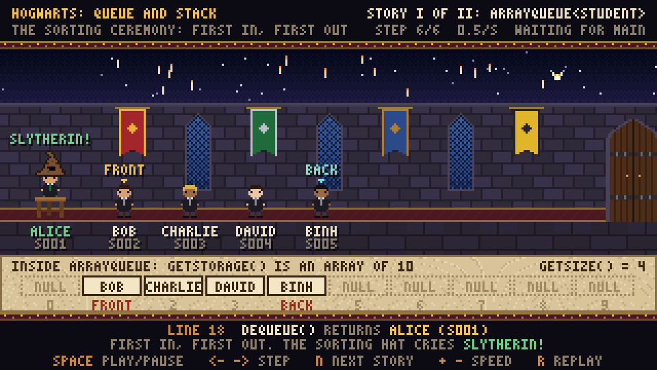
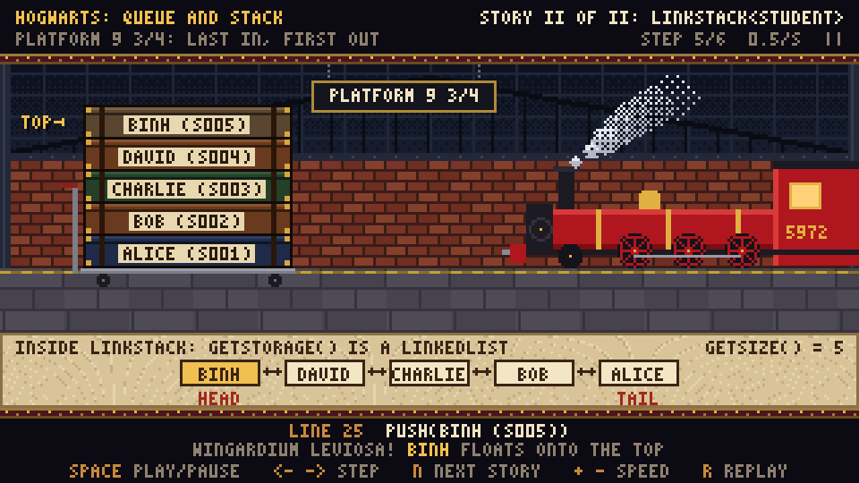

# Hàng đợi (Queues)

| Package | Class | Syllabus | Giáo trình |
|---|---|---|---|
| `queue` | `Queue` | 2.2 Queues | 6.2.1 |
| `queue` | `ArrayQueue` | 2.2 Queues | 6.2.2 |
| `queue` | `HogwartsVisualizer` | phát lại từng lời gọi trên một `Queue` hay `Stack` | |
| `queue.sample` | `Student`, `QueueDemo` và `HogwartsVisualizerDemo` | chạy thử | |

## Cây kế thừa

```
Queue<T>               enqueue, dequeue, peek, getSize, isEmpty, getStorage, toList, toString
└── ArrayQueue<T>      mảng vòng: front, size, ô ghi tiếp theo là (front + size) % capacity
```

## Hợp đồng của Queue

Theo slide 7 bài Queue: hàng đợi không nhận phần tử `null`, nên `null` trả về nghĩa là hàng rỗng.

| Method | Việc làm | Khi hàng rỗng |
|---|---|---|
| `enqueue(x)` | thêm `x` vào cuối hàng; `x == null` ném `NullPointerException` | |
| `dequeue()` | lấy phần tử ở đầu hàng ra và trả về | trả về `null` |
| `peek()` | trả về phần tử ở đầu hàng, giữ nguyên hàng | trả về `null` |
| `toList()` | `java.util.List` các phần tử từ đầu tới cuối hàng | `[]` |
| `getStorage()` | chỗ chứa bên trong, với `ArrayQueue` là cả mảng kể cả ô trống | |

## ArrayQueue

`new ArrayQueue<>(new String[5])` tạo hàng chứa tối đa 5 phần tử. Lý do bên gọi đưa mảng vào giống
`ArrayStack`, xem [`stack/README.md`](../stack/README.md).

`front` là ô sẽ bị lấy ra tiếp theo. `enqueue` ghi vào ô `(front + size) % capacity`, `dequeue` gán
`null` vào ô `front` rồi dời `front` sang `(front + 1) % capacity`. Không phần tử nào phải dịch chỗ.
`enqueue` khi hàng đã đầy ném `IllegalStateException` và hàng giữ nguyên.

Slide 11 có một mảng, hai cách nhìn. Hàng 5 ô nhận `A` tới `E`, lấy ra `A`, `B`, rồi nhận `F`, `G`:

| Cách nhìn | Giá trị |
|---|---|
| `getStorage()`, các ô `a[0..4]` | `F, G, C, D, E` |
| `toList()`, thứ tự FIFO | `C, D, E, F, G` |
| `front`, `size` | 2, 5: hàng đầy, `enqueue("H")` bị từ chối |

Bản viết trên lớp không kiểm tra hàng đầy, nên `enqueue` thứ `capacity + 1` ghi đè lên phần tử ở đầu
hàng mà không báo gì. `toString` của bản đó in các ô theo thứ tự trong mảng, nên sau khi vòng lại
thì in `[D, B, C]` thay cho `[B, C, D]`.

## HogwartsVisualizer



Bọc một `Queue` hay `Stack` ngay sau `new`, rồi dùng như bình thường:

```java
Queue<Student> line = HogwartsVisualizer.watch(new ArrayQueue<>(new Student[10]));
Stack<Student> trolley = HogwartsVisualizer.watch(new LinkStack<>());
```

Visualizer ghi lại từng lời gọi `enqueue`, `dequeue`, `push`, `pop`, `peek`, `isEmpty` trên đối
tượng mà `watch` trả về, rồi phát lại từng bước trong một cửa sổ pixel-art. Queue là hàng học sinh
trong Đại sảnh chờ Mũ Phân loại; stack là chồng rương trên xe đẩy ở sân ga 9 3/4. Phần chữ dưới
cùng ghi số dòng code đã gọi method, lời gọi và giá trị trả về.



Tấm giấy da phía dưới vẽ `getStorage()`. Mảng hiện thành dãy ô có chỉ số, ô trống ghi `NULL`, kèm
nhãn `FRONT`, `BACK` hoặc `TOP`. `LinkedList` hiện thành các node nối hai chiều, kèm nhãn `HEAD` và
`TAIL`.

Visualizer tự giữ một hàng đợi (hay ngăn xếp) chuẩn để đối chiếu, nên nó vẽ được cả code sai của
sinh viên. Bước nào cấu trúc làm khác bản chuẩn thì phần chữ dưới cùng thêm một dòng đỏ:

| Code sai | Visualizer báo |
|---|---|
| `dequeue` hay `pop` trả sai phần tử | `BUT THE FRONT OF THE LINE WAS ...` hoặc `BUT THE TOP TRUNK WAS ...` |
| `getSize()` lệch với số phần tử thật | `BUT GETSIZE() SAYS 3, NOT 2` |
| `isEmpty()` trả sai | `BUT NOTHING IS IN LINE` hoặc `BUT 2 ARE IN LINE` |
| một phần tử biến khỏi `getStorage()`, ví dụ bị ghi đè | `BUT ... IS NO LONGER INSIDE` |
| `prev` của một node không trỏ về node trước | mũi tên đỏ giữa hai node |
| `tail` không trỏ vào node cuối | nhãn `TAIL?` |
| method ném ngoại lệ | tên ngoại lệ; visualizer ném lại ngoại lệ đó cho chương trình |

Phím: `Space` chạy hoặc dừng, `<-` và `->` lùi hoặc tiến một bước, `1` tới `9` chọn cấu trúc theo thứ
tự gọi `watch`, `N` sang cấu trúc kế tiếp, `R` phát lại từ đầu, `+` và `-` đổi tốc độ, `Esc` thoát.

Mỗi lần chạy theo dõi được tối đa 9 cấu trúc, mỗi cấu trúc ghi tối đa 400 bước. `watch` chỉ nhận cấu
trúc còn rỗng; cấu trúc đã có phần tử làm `watch` ném `IllegalArgumentException`. Khi không có màn
hình, như trên GitHub Actions, `watch` in một dòng thông báo và chương trình chạy tiếp bình thường.

## Chạy

Với JDK 22 trở lên, đứng ở thư mục gốc của repo:

```bash
java queue/sample/HogwartsVisualizerDemo.java
```

Với JDK 8 đến 21, biên dịch cả `stack` và `list` vì visualizer vẽ được stack:

```bash
mkdir -p out
javac -d out $(find queue stack list -name "*.java")
java -cp out queue.sample.HogwartsVisualizerDemo
```

`QueueDemo` in kết quả ra console, không mở cửa sổ.
